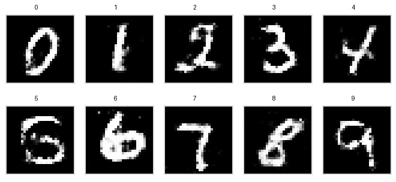

# GAN Web App

A full-stack AI image generation application powered by a PyTorch Conditional GAN (CGAN). The system generates `28x28` handwritten digits conditioned on labels `0-9`, served via Flask and consumed by a React + Tailwind frontend.



## Highlights

- End-to-end CGAN inference pipeline (frontend + backend)
- Label-conditioned digit generation (`0-9`)
- JSON API with Base64 PNG output
- Clean, responsive React UI with loading states and multi-variation output
- Built-in retraining script for checkpoint improvement

## Tech Stack

- **Backend:** Flask, PyTorch, NumPy, Pillow
- **Frontend:** React, Vite, Tailwind CSS
- **Model:** MLP-based Conditional GAN trained on MNIST

## Project Structure

```text
gan-web-app/
├── backend/
│   ├── app.py
│   ├── generator.py
│   ├── generator_cgan.pth
│   ├── requirements.txt
│   ├── sample_grid.png
│   └── train_cgan.py
├── frontend/
│   ├── index.html
│   ├── package.json
│   ├── postcss.config.js
│   ├── tailwind.config.js
│   ├── vite.config.js
│   └── src/
│       ├── App.jsx
│       ├── index.css
│       ├── main.jsx
│       └── components/
│           └── GeneratorUI.jsx
└── README.md
```

## Quick Start (Windows)

### 1) Backend setup

From project root:

```powershell
cd gan-web-app
.venv\Scripts\Activate.ps1
cd backend
python -m pip install -r requirements.txt
python app.py
```

Backend URLs:

- API root: `http://127.0.0.1:5000/`
- Health: `http://127.0.0.1:5000/health`

### 2) Frontend setup

Open a second terminal:

```powershell
cd gan-web-app\frontend
npm install
npm run dev
```

Frontend URL:

- App: `http://127.0.0.1:5173`

## API Reference

### `GET /`

Returns API metadata and endpoint hints.

### `GET /health`

Health-check endpoint.

Example response:

```json
{
  "status": "ok"
}
```

### `POST /generate`

Generates a digit image for a selected label.

Request body:

```json
{
  "digit": 7,
  "noise": [0.13, -0.41, 0.55]
}
```

Request fields:

- `digit` (**required**): integer in `0-9`
- `noise` (**optional**): array of exactly `100` numeric values

If `noise` is omitted, the backend samples latent noise internally.

Successful response:

```json
{
  "digit": 7,
  "image": "data:image/png;base64,...",
  "noise": [0.13, -0.41, 0.55, ...]
}
```

## Model Notes

The inference service uses only the **Generator**.

- Latent vector: `100` dimensions
- Label embedding: `10` classes
- Architecture: `110 -> 256 -> 512 -> 1024 -> 784`
- Output activation: `Tanh`
- Final image shape: `1 x 28 x 28`

The Discriminator is used during training only and is not required for inference requests.

## Retraining

To retrain checkpoints on MNIST:

```powershell
cd gan-web-app\backend
python train_cgan.py --epochs 20 --batch-size 128 --workers 0
```

This updates:

- `backend/generator_cgan.pth`
- workspace root `discriminator_cgan.pth`

Restart the backend after retraining so new weights are loaded.

## Configuration

Set a custom backend URL for the frontend with `frontend/.env`:

```text
VITE_API_BASE_URL=http://localhost:5000
```

## Troubleshooting

### `ModuleNotFoundError` for `torch` or `numpy`

- Ensure you activated the project venv: `.\.venv\Scripts\Activate.ps1`
- Confirm interpreter path: `python -c "import sys; print(sys.executable)"`
- Reinstall backend dependencies: `python -m pip install -r requirements.txt`

### Backend shows `Not Found`

- `GET /generate` is not valid (generation requires `POST`)
- Use `http://127.0.0.1:5000/` or `/health` for browser checks

### Generated digits look poor

- Use the retraining script for additional epochs
- MLP-based CGAN quality is lower than convolutional GAN variants

## Roadmap

- Upgrade to a convolutional CGAN/DCGAN for sharper samples
- Add optional sampling controls (seed, temperature-like controls)
- Add export/download support for generated outputs

## Publish to GitHub

Use these commands from the project root (`gan-web-app`):

```powershell
git init
git add .
git commit -m "Initial commit"
git branch -M main
git remote add origin https://github.com/<your-username>/<your-repo>.git
git push -u origin main
```

Notes:

- The local MNIST training data (`backend/data/`) is ignored and will not be uploaded.
- `backend/generator_cgan.pth` is kept in version control for ready-to-run inference.